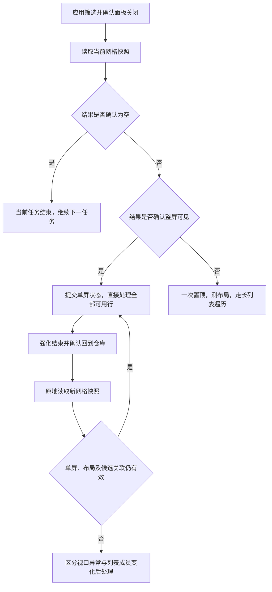

# 仓库导航与恢复优化改造方案

日期：2026-10-05。状态：待实施方案。

本方案依据最近一轮 `20261005-133401` 的 DEBUG 日志、统计、步骤截图及当前源码。目标是减少筛选后、强化后的仓库页签往返，同时保留必要的页面确认、重新识别和进度保护。本次交付为分析与设计文件。

## 1. 结论与优先级

建议实现以下三项，按顺序落地：

1. **删除筛选后的第二次无条件切页置顶。** 当前两次置顶之间只是截图和布局测量，没有输入，也没有改变仓库视口。这次重复置顶可以直接消除。
2. **筛选结果整屏可见时，直接进入单屏处理。** 当前布局每屏 9 列 × 4 行，共 36 个格位。确认所有结果已经完整显示后，筛选后的第一次置顶、末行延期和滚轮探底都可以省掉。
3. **单屏任务强化结束后，原地重扫并继续处理。** 确认回到仓库并重新识别当前网格后，无需切到音擎页再切回，也无需建立滚轮恢复路径。

你的判断适用于**已确认完整显示的单屏列表**。这能消除长列表中的滚动偏移问题。强化后的等级、排序和筛选成员变化仍需检查，因此原地重新扫描应保留。

长列表和无法确认完整显示的列表保留一次置顶及原有恢复机制，作为另一条执行路径。

## 2. 本轮证据

### 2.1 实测范围

13:34:01 开始，13:44:12 用户手动停止，总耗时 610.619 秒；停止前处理 24 个盘，日志无运行失败。覆盖了筛选、列表扫描、详情判定、19 次升阶操作、强化后弃置收尾及 9 次恢复。没有覆盖最终升满 15 级保留，因此不能把本轮描述为整条任务链成功完成。

| 任务 | 条件（均选择河豚电音、静听嘉音、折枝剑歌） | 盘数 | 处理数 | 置顶往返次数 | 页签切换次数 |
| --- | --- | ---: | ---: | ---: | ---: |
| 1 | 1 号位 | 34 | 9 | 2 | 4 |
| 2 | 2 号位 | 10 | 0 | 2 | 4 |
| 3 | 3 号位 | 23 | 5 | 4 | 8 |
| 4 | 4 号位、攻击力% | 16 | 5 | 5 | 10 |
| 5 | 4 号位、暴击率 | 14 | 5 | 6 | 12 |
| 合计 | 5 个任务 | 97 | 24 | **19** | **38** |

这里一次“置顶往返”指“驱动盘页 → 音擎页 → 驱动盘页”，包含两次页签切换。19 次由筛选后 10 次、强化后 9 次组成。

五个任务的首批截图都确认结果完整显示：34、10、23、16、14 个，全部不超过 36 个。证据为 `0006`、`0047`、`0052`、`0088`、`0133` 的扫描列表截图。

9 次强化后恢复全部记录为“已恢复到全局第 1 行视口”，没有恢复向下滚动，没有“恢复滚动完成，等列表稳定”记录。当前仍走了完整置顶路径。

另有 **5 次正常前进请求被端点截停：请求 2 行、实际 0 行**。这说明短列表已经完整显示，却仍通过点击锚点、发送滚轮来确认底部。

### 2.2 时间与 OCR

| 环节 | 次数 | 合计 | 平均 |
| --- | ---: | ---: | ---: |
| 设置游戏筛选 | 5 | 187.955 秒 | 37.591 秒 |
| 筛选后切页置顶及布局复核 | 5 | 44.415 秒 | 8.883 秒 |
| 强化后恢复中的切页置顶 | 9 | 32.703 秒 | 3.634 秒 |
| 滚轮协议准备 | 5 | 5.362 秒 | 首次耗时，后续复用 |
| 到驱动盘仓库 | 5 | 3.160 秒 | 0.632 秒 |

全轮 309 次 OCR，累计 172.100 秒。其中列表区域 `(60,80,1330,1020)` 识别 34 次，累计 43.740 秒；全屏 OCR 20 次，累计 32.475 秒。

OCR 时间包含在业务环节时间内，不能再相加。步骤统计中的 `restore` 合计 60.3 秒是相邻 Trace 的间隔，不能与 32.7 秒切页时间叠加。

原始数据已存档：[本轮日志与统计](../log/debug/plan4-nav-review-20261005-133401/)、[导航次数及 OCR 分布](../log/debug/plan4-nav-review-20261005-133401/metrics.json)、[逐任务次数](../log/debug/plan4-nav-review-20261005-133401/by-job.json)。

## 3. 当前代码为什么会切页

### 3.1 筛选后

调用路径：`Runner._run_job → _prepare_navigation`。

当前流程：

```text
关闭筛选面板
  → reset_to_top：切音擎页、切回驱动盘页
  → 重新截图
  → measure_layout：OCR 等级标签，测原点与行距
  → check_layout_reference：检查布局是否受支持
  → 更新本轮导航参数
  → 再次 reset_to_top
  → 主循环再截图、再 OCR 列表
```

第一次置顶用于建立已知的顶部原点。第二次置顶目前没有独立效果：中间的布局测量和参数更新都是只读操作。对于已确认完整显示的单屏列表，第一项的原点也可以直接由当前画面确认。

布局 OCR 和首次扫描 OCR 还读取了同一个列表区域，存在合并为单次识别的机会。

### 3.2 强化后

调用路径：`_process_cell → _upgrade_loop → finish_upgrade → _restore_position → _restore_once`。

当前一次恢复会：

1. 保存强化前视口；一件盘连续升阶期间沿用同一恢复点。
2. 强化结束后返回仓库，提交该件进度，旧候选坐标失效。
3. 切页置顶，重新读取原点与行距。
4. 根据保存视口决定是否向下滚动。
5. 扫描目标网格，校验成功后将扫描结果交给主循环复用。

本轮第 4 步全部为 0 行，但第 3 步仍执行了 9 次。这正是单屏路径可以消除的部分。当前“恢复后扫描结果只识别一次并复用”已有实现，应继续保留。

### 3.3 末行为什么还会探底

首批一律初始化为 `at_top=True, at_bottom=False`。`split_stable_cells` 因而先延后最后一行。现有 `_single_screen_tail` 要求没有中间行锚点，只能解决很短的一行列表；本轮 2–4 行列表均走正常前进，通过实际位移为 0 才接受到底。

改造应把“完整单屏”扩展为 1–4 行，而不是继续依靠“没有中间行锚点”判断短列表。

## 4. 单屏路径的判定

定义单屏容量：`capacity = GRID_COLS * GRID_ROWS`，当前为 36。判断数量使用游戏仓库显示的**筛选后总盘数**，包含满级、装备、锁定、弃置等盘，不能使用“待处理数”“处理上限”“卡片数量”或扣除跳过项后的数量。

接受单屏路径应同时满足：

- 游戏窗口绑定正确，分辨率及布局受支持，筛选面板和强化弹层已关闭，当前是驱动盘仓库页。
- 仓库数量可靠识别，`0 ≤ N ≤ capacity`。
- 非空结果的实体盘全部映射到当前标准网格，数量与 N 相同，格位从首行首列连续排列，无漏识别、重复映射、中间缺口或半行偏移。
- 其余格位确认为游戏空占位；布局原点和行距通过检查。
- 判断来自动作结束后已稳定的同一帧；筛选条件、窗口和布局签名与当前任务一致。

数量及等级标签优先从现有 `LABEL_SCAN_AREA` 的同一次 OCR 中解析，避免为了判定增加整屏 OCR。若数量不在识别结果中，再使用仓库标题小区域补读。

**恰好 36 个必须校验仓库总数。** 满屏没有空位，单靠 `_tail_slots_confirmed` 无法区分“只有 36 个”和“长列表的前 36 个”。

`N=0` 延用已实现的“正确页面、数量为零、空占位全部确认”路径，正常结束当前任务。数量不明或识别不一致时不能强行填写顶部行号与相位为 0，采用既有受限重试及长列表准备路径。

建议任务状态增加 `viewport_mode`：`unknown / single_screen / scrolling`，与筛选签名、窗口和布局签名绑定。只有完整证据通过才提交 `single_screen`，并设置 `top_row0=0、phase=0、at_top=True、at_bottom=True`。

## 5. 目标流程



### 5.1 筛选结束

关闭面板后先读取当前画面。单屏判定成功，直接建立首批状态并复用该扫描结果；不调用 `reset_to_top`、不发送探底滚轮，首行及末行均可处理。

长列表或证据不足，调用一次 `reset_to_top`，确认原点后测布局并获取正式网格。删除第二次无条件置顶。不能仅凭“设置筛选通常会回顶”对所有长列表宣告到顶；是否进一步省掉长列表第一次置顶，作为后续独立验证项。

### 5.2 一件盘强化结束

连续升阶仍在强化页内完成，保留各档等级、副词条及素材不足检查，不在每升一档后重新读仓库。

确认返回仓库后：

- 已达到任务额度或收到停止请求，按现有规则收尾，不追加切页、滚轮或恢复动作。
- 任务处于单屏模式，读取一次新快照，校验布局、总数、占位及候选关联；通过后使用新坐标继续，缓存新扫描结果给主循环。
- 长列表仍按保存视口恢复，保留协议、实际位移/相位检查、恢复请求上界与受限重试。

新快照必须产生新的候选坐标。动作前的候选列表和截图不可直接沿用到强化后。

### 5.3 单屏任务结束

`at_top` 和 `at_bottom` 同时已确认，直接处理全部待处理行；候选耗尽时结束当前任务。无需为了释放末行而先点击锚点、向下滚 2 行，再确认实际位移为 0。

单屏原地重扫不增加工作批次，不重置当前任务额度，不重新计数已经完成的同一件盘。

## 6. 必须处理的进度问题

视口定位和物品关联是两个问题。现有 `TraversalState.next_index` 按**格位序号**提交进度，代码也明确把强化后的排序变化视为坐标失效。单屏确认只能证明整张列表可见，不能证明原来的第 k 格仍是同一件盘。

第一阶段采用以下规则：

| 强化后变化 | 处理 |
| --- | --- |
| 数量、其他格位关联保持不变，仅当前盘等级/标签更新 | 原地重扫，通过校验后继续使用格位进度 |
| 页面或相位异常，但列表成员与关联未改变 | 放弃快速路径，使用既有置顶定位恢复 |
| 某盘退出筛选、数量减少或其他盘顺序变化 | 旧候选及格位关联失效，禁止简单沿用 `next_index=旧序号+1` |
| 无法区分列表重排与普通视觉变化 | 不跨过未知候选；记录诊断并终止本任务链，待关联规则完善 |

例如处理索引 8 的盘后，该盘退出筛选，原索引 9 的未处理盘会补到索引 8。直接从 9 继续将漏掉它。**再次切页置顶也不会恢复物品原来的身份关联**，不能把切页回退当作解决成员变化的保证。

建议保留强化前后网格快照，对非当前格位的图标、等级、占位和标签变化做检查。这能发现可观察的变化，但不能唯一识别所有外观相同的盘。不得将图片相似度称作可靠物品 ID。

若要支持列表动态删除或任意重排，需单独增加候选关联机制：记录完成盘的识别特征、更新强化后的特征，并按重复数量处理相同盘；关联出现歧义时保留未知，不能按新格位序号直接重建完成前缀。该机制属于第二阶段，应独立设计和验收，避免把身份问题混进本次省切页改造。

## 7. 代码改造落点

| 文件/位置 | 改造内容 |
| --- | --- |
| `runner.py::_prepare_navigation` | 先读取当前快照、尝试空结果/单屏确认；长列表只置顶一次；返回准备模式和首批扫描结果 |
| `runner.py::_run_job` | 依据准备结果初始化上下端点；使用首批快照；单屏任务不做探底前进 |
| `runner.py::_restore_position` | 增加单屏原地复核分支；视口回退与成员变化使用不同处理结果 |
| `runner.py::_restore_once` | 保留长列表恢复，提供明确的回退入口 |
| `runner.py::_scan_cells` | 支持传入已有截图/OCR 标签，避免准备、布局测量、正式扫描重复抓图和识别 |
| `navigation.py::measure_layout` | 拆出纯标签测量函数，允许复用既有 OCR 结果 |
| `traversal.py::TraversalState` | 保存单屏确认模式和关联有效性；原地重扫不增加工作批次 |
| `traversal.py::split_stable_cells / tail_slots_confirmed` | 复用已有稳定行和占位验证；补充满屏 36 个、总数一致性判断 |
| `stats.py / Trace` | 区分单屏确认、原地复核、切页置顶、回退原因；扫描次数和工作批次分别记录 |
| 使用说明及导航注释 | 更新“两次置顶”“强化后一律恢复”等当前约定，说明新分支的成立条件 |

建议统一 `GridSnapshot`，承载：当前截图、页面、窗口及分辨率、识别数量、原始标签、布局、格位、空占位、跳过项、识别问题。准备、扫描与恢复共享快照，只有发生新的输入或画面变化后才重新读取。

任务内快照不得跨任务、跨筛选签名或跨窗口复用。全局勾选卡片、评分、档位、打标签策略、未生成任务跳过和处理额度保持现有语义。

## 8. 分阶段实施

### 阶段一：消除确定多余的导航

1. 删除第二次无条件置顶，保留长列表首次置顶及布局确认。
2. 实现总数量、完整网格和相位一致的单屏确认。
3. 单屏初始化上下端点同时成立，省掉末行延期和探底。
4. 强化后原地复核，仅在成员及关联有效时继续；视口异常回退，成员变化独立处理。
5. 打通快照复用，增加可审计的模式与原因日志。

建议作为一次完整改造交付。仅删切页而不调整末行策略，会留下本轮 5 次无效探底；仅加单屏模式而不处理强化后关联，也会留下漏盘风险。

### 阶段二：扩展与剩余性能优化

| 项目 | 本轮依据 | 建议 |
| --- | --- | --- |
| 筛选增量更新 | 5 个任务套装完全相同，筛选共 188 秒 | 确认已选状态后，只更新变化的条件；手动干涉、异常或签名变化后重新建立状态 |
| 套装弹层局部 OCR | 20 次全屏 OCR，共 32.5 秒 | 缩小套装和确认按钮区域，保留滚动寻找及确认 |
| 快照与步骤截图复用 | 切页、布局、扫描间有额外截屏 | 保存已确认的动作后帧，不再次截同一状态 |
| 读取强化页结果 | 多档判定和素材不足检查已有覆盖 | 复用同一帧的等级/副词条解析；实际升级后仍重新读结果 |
| 候选动态关联 | 格位进度无法唯一识别重排后的物品 | 为成员变化建立独立关联机制，不能依赖切页回退 |
| 长列表筛选后免置顶 | 本轮全部为单屏，未验证这一条件 | 在有明确到顶证据时再支持，当前长列表保留一次置顶 |

首次滚轮协议准备属于每轮一次的必要导航准备，本轮仅 5.36 秒，优先级低。若未来希望单屏任务完全不准备滚轮协议，需要延迟到首次长列表再标定，并解决标定前重置筛选、标定后重应用当前任务的问题，宜另立改造项。

## 9. 收益估算

以本轮恢复切页平均 3.634 秒作为参考：

- 仅删除每任务第二次置顶，约减少 5 次往返、10 次页签切换，约 **18 秒**。
- 五个单屏任务均通过快速路径后，可减少筛选后全部 10 次往返，约 **36 秒**。
- 9 次强化后的单屏原地复核均通过，可再省去实测的 **32.703 秒**切页时间。
- 合计纯切页部分约 **69 秒**，占本轮总时间约 **11%**；理论上本轮 38 次自动页签切换可以全部消除。

这是基于已观测切页耗时的量级估算，首批直接确认及关联检查会有成本，不能承诺净省 69 秒。布局/扫描去重和 5 次无效探底还有额外收益，但避免在未独立测量前重复计入。

保留必要扫描后，不能把全部 44.4 秒布局准备和全部 60.3 秒恢复步骤间隔都算作可删时间。实施后按快照识别、布局测量、切页、滚轮、原地复核分别计时，再比较净收益。

## 10. 验收要求

优先用本轮存档截图和无真实输入的替身测试验证分支，实施后再进行针对性游戏验证。

| 场景 | 预期行为 |
| --- | --- |
| 0 个结果 | 正常结束当前任务，继续下一项，不切页探底 |
| 1、9、10、27、34、35 个 | 数量与完整格位一致时进入单屏；末行不延期，无探底滚轮 |
| 恰好 36 个 | 确认总数为 36 且 36 格完整，进入单屏 |
| 37 个或更多 | 不因首屏只有 36 格而接受单屏；保留一次置顶和长列表遍历 |
| 总数读成 16、只识别到 15 格 | 不接受单屏，重读或按异常/回退处理，不跳过缺口 |
| 一屏内强化，布局及关联不变 | 返回仓库后原地重扫，无仓库页签点击，无恢复滚轮，无重复计数 |
| 强化后成员减少或顺序变化 | 使旧候选关联失效，不直接沿用旧 `next_index`；记录变化原因 |
| 视口存在半行偏移或窗口尺寸变化 | 单屏证据失效，按定位异常处理 |
| 切换任务或修改筛选 | 清除上一任务单屏证据及缓存 |
| 处理额度已达或 F10 停止 | 不追加恢复动作；保留现有输入前检查 |
| F9 暂停发生在原地复核/回退中 | 暂停生效，恢复后不重复已完成输入 |
| 长列表强化后恢复 | 保留保存视口、恢复上界、相位检查和最多两次重试 |

新增日志至少应记录 `viewport_mode`、筛选后总数、完整可见格数、布局/相位、确认或拒绝原因、原地复核次数、切页往返次数、回退原因、扫描次数、工作批次、处理额度和候选关联状态。

阶段一完成标准：在与本轮等价的单屏且成员关联稳定场景中，筛选和强化恢复的页签切换计数为 0，完整处理末行；结果、计数、暂停/停止和异常处理语义保持正确。证据不足的场景应明确回退或停止，不能悄悄跳过未处理盘。
