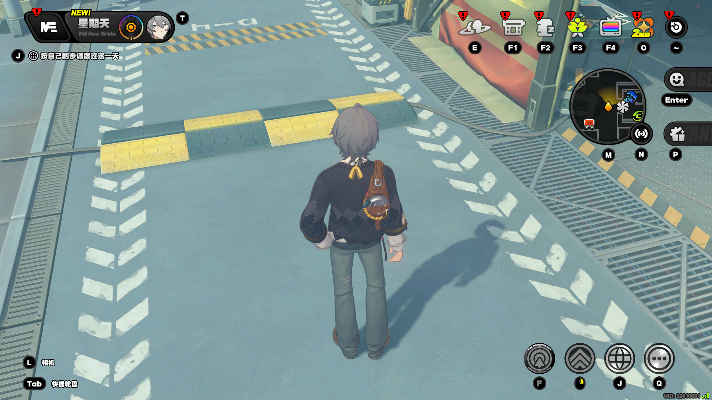
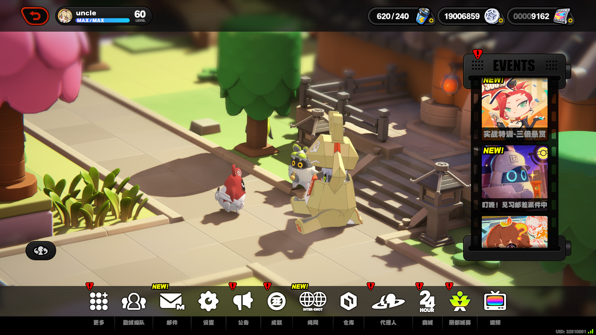
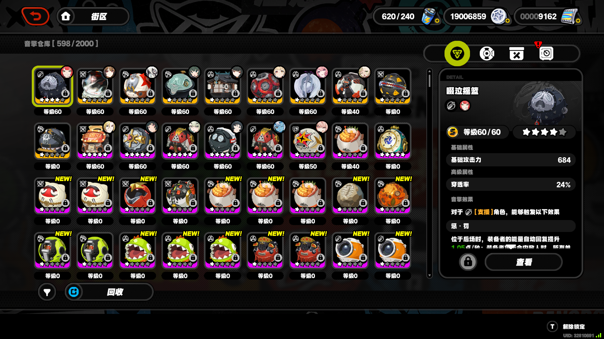
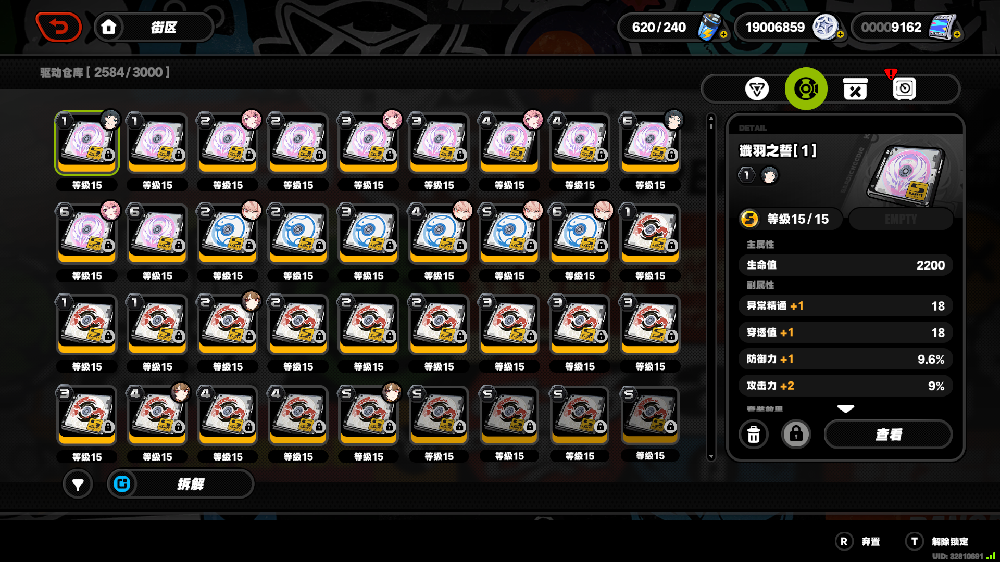
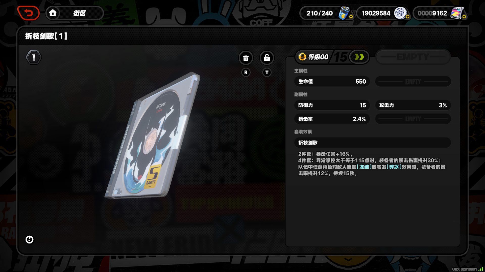
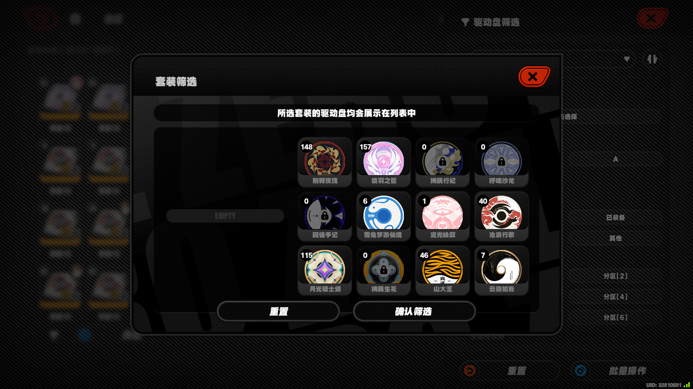

# 01 页面识别（安全底线）

认页回答「现在在哪一页」，只读画面，**不执行**强化、弃置、拆解或回收。判据分三层：

- **严格模板校验**（`screen.is_page`）：本页列出的锚点图标必须全部过线。
- **导航分类**（`screen.classify_image`）：先逐页严格校验，全部不命中才走启发式。
- **弹层与层级识别**（`screen.is_disc_modal` / `screen.is_disc_preview` / `screen.is_upgrade_stage_add`）：详情弹层、缩放预览层与强化页各有独立判据。

配套文档：

- 模板匹配口径、分数计算与识别性能约束：[识别标定](./识别标定.md)
- 点击 / 滚轮协议、等待常量与停止边界：[输入与等待](./输入与等待.md)
- 客户区基准、设计坐标与截图方式：[截图与坐标](./截图与坐标.md)

## 1. 判页口径

`screen.is_page(image, page)` 在规定矩形中做归一化相关（NCC），该页列出的图标必须**全部**过线才返回 `True`。驱动盘仓库到达、切页结果及位置恢复都用这一校验，失败按调用方的有限重试规则处理。

`screen.classify_image(image)` 先逐页调用严格校验，全部未命中再兜底启发式：

- 底部亮图标数量 ≥ 10 → 功能菜单；
- 大世界提示区白色像素比例 ≥ 0.04 → 大世界；
- 其余 → `unknown`。

启发式**不返回**音擎仓库或驱动盘仓库，不能等同于「所有模板已通过」。日志会区分「模板命中」和「启发式兜底」。

运行模板从包内 `src/zzz_ddtool/assets/templates/` 加载；判定定义在 `src/zzz_ddtool/screen.py::PAGE_MARKS`。矩形是 1920×1080 设计坐标，按实际客户区缩放，模板同步缩放，并允许在矩形外扩 16px（同样按比例）的范围内滑窗：

| 页面 | 锚点图标 | 运行模板 | 矩形 (左,上,右,下) | 阈值 |
| --- | --- | --- | --- | ---: |
| 大地图 | 快捷轮盘 | `world/quick_wheel.png` | 40, 990, 230, 1068 | 0.80 |
| 功能菜单 | 菜单返回 | `menu/back.png` | 82, 13, 150, 90 | 0.75 |
| 功能菜单 | 底部仓库 | `menu/warehouse.png` | 1088, 928, 1160, 1048 | 0.85 |
| 音擎仓库 | 音擎仓库标题 | `storage/title.png` | 74, 112, 164, 168 | 0.85 |
| 音擎仓库 | 回收 | `storage/recycle.png` | 250, 900, 438, 960 | 0.94 |
| 驱动盘仓库 | 驱动仓库标题 | `discs/title.png` | 74, 112, 164, 168 | 0.85 |
| 驱动盘仓库 | 拆解 | `discs/dismantle.png` | 250, 900, 438, 960 | 0.94 |

判定顺序为驱动盘仓库 → 音擎仓库 → 功能菜单 → 大地图（`screen.PAGE_ORDER`）。

## 2. 导航容错范围（`nav.goto_warehouse`）

从任意正常操作状态回到驱动盘仓库最多 **8 轮**，逐状态处理：

| 当前页 | 处理 |
| --- | --- |
| 驱动盘仓库 | 直接完成 |
| 音擎仓库 | 点驱动盘页签；切页结果仍以严格仓库校验收尾 |
| 功能菜单 | 点仓库入口 |
| 大地图 | Esc 出菜单 |
| `unknown` | 保存现场图后 Esc 剥一层残留弹层 |

只有严格确认驱动盘仓库才返回成功。`unknown` 连续超过 **3** 层即中断，计数只在非 `unknown` 页面（含大世界、功能菜单）清零。超出容错范围时抛 `NavError`：**不允许**用功能菜单或大世界的启发式结果替代仓库验证。导航全程不点强化、弃置、拆解。

## 3. 大地图页

整页样本：`tests/fixtures/大地图/普通大世界.png`（1920×1080，可见角色、大世界 HUD 与左下角「Tab 快捷轮盘」）。

判据模板：`src/zzz_ddtool/assets/templates/world/quick_wheel.png`

左下角「Tab 快捷轮盘」只有大世界才有，是本页唯一判据。它只用于识别 `overworld` 页，**不代表**任何战斗或特殊场景都能直接开始；画面上有正常的大世界 HUD 也不能当作驱动盘页面识别成功。从大世界进仓库要先出功能菜单，有独立导航步骤。

## 4. 功能菜单页

整页样本：`tests/fixtures/功能菜单/仓库入口.png`（1920×1080，下方菜单可见「仓库」，上方有返回箭头）。

判据模板（两个都要过）：`src/zzz_ddtool/assets/templates/menu/back.png`、`src/zzz_ddtool/assets/templates/menu/warehouse.png`

这是从大世界打开的功能菜单，**不是仓库**。进入仓库的点击锚点是底部仓库图标中心（`layout.WAREHOUSE_BTN`），时序见 [输入与等待](./输入与等待.md)。

误判边界：

- 返回箭头在多个页面都出现，**不能只凭箭头**认仓库或认菜单。
- 连续 Esc 会把仓库页退到这里，不能把这种退出误判成列表已处理完。
- 切页置顶与「退出主页再进会丢筛选」的差别见 [G05](../游戏规则.md#g05)。

## 5. 音擎仓库页

整页样本：`tests/fixtures/音擎仓库/仓库列表.png`（1920×1080，左上「音擎仓库」、底部「回收」、右上音擎页签选中）。

判据模板（两个都要过）：`src/zzz_ddtool/assets/templates/storage/title.png`（只含「音擎仓库」四字，不含数量）、`src/zzz_ddtool/assets/templates/storage/recycle.png`

点「仓库」之后的默认页。它**不是**要处理的驱动盘列表，只用于导航与 [G05 切页置顶](../游戏规则.md#g05)；工具不操作音擎回收。

误判边界：

- 「回收」和驱动盘仓库页的「拆解」外观相似，**必须再对标题**才能区分两个仓库，不能只凭底部按钮认页。
- 驱动盘页签切回音擎再回来会回到顶部，并保留筛选与等级排序（[G05](../游戏规则.md#g05)）。

## 6. 驱动盘仓库页

整页样本：`tests/fixtures/驱动盘仓库/列表与侧栏.png`。另有 `tests/fixtures/驱动盘仓库/升级前-34件-序号32.png`、`升级后-34件-序号28.png`（升级前移）与 `标签-已弃置.png`（弃置标签外观）可用。

判据模板（两个都要过）：`src/zzz_ddtool/assets/templates/discs/title.png`（只含「驱动仓库」四字，不含数量）、`src/zzz_ddtool/assets/templates/discs/dismantle.png`

从音擎仓库点右上第二枚页签进来。

页面上各元素表示什么：

| 元素 | 含义与工具处理 |
| --- | --- |
| 9 列 × 4 行网格 | 仓库常规视口；第 2 / 3 行点击不会引起自动滚动，首 / 末行可能使焦点自动居中（[G03](../游戏规则.md#g03)） |
| 格子「等级」数字 | 任务按等级降序扫描，15 级在前、0 级在后（[G04](../游戏规则.md#g04)） |
| 满级 / 已装备盘 | 仍占物理格位，序号不能压缩。满级盘在扫描阶段直接跳过（`skip_max_level` 缺省开启）；已装备判据当前停用，装备盘与普通盘一样处理 |
| 格子右上角角色头像 | 表示已装备。现行扫描不读头像，判据与恢复方法见 [识别标定](./识别标定.md) |
| 锁标 / 弃置标 | 盘面状态标签；已锁定盘直接 R 会有确认弹窗，工具先 T 解锁（[G07](../游戏规则.md#g07)） |
| 格子上的金色稀有度小牌（`S` 等） | 当前代码不读它；稀有度由点开盘面后「等级 03/15」的分母推出（[G08](../游戏规则.md#g08)） |
| 左侧筛选漏斗 | 筛选面板入口；其后是青蓝色「拆解」入口，两者位置接近 |
| 右侧选中盘摘要 | 点选格子后更新的侧栏，**不是**详情弹层 |

误判边界：

- **驱动盘页签不参与判页**：页签切到驱动盘后会变选中态（黄底），模板分会掉到 0.81 左右摇摆，本页会时认时否；标题本身已能区分两个仓库。`src/zzz_ddtool/assets/templates/discs/tab.png` 仍在，但源码里没有调用点，导航点击走 `layout.DRIVE_DISC_TAB` 的硬编码坐标。
- **红色返回箭头不能判仓库页**：详情 / 缩放页顶部有同样的红箭头，会把缩放页误判成仓库页；认不出就老实返回 `unknown`。
- 「拆解」只作路标。认页层不分解；点击坐标落在拆解区时按禁止区拒绝（`layout.DISMANTLE_FORBID`）。
- 强化后盘按新等级前移，选中焦点也可能跟随；恢复进度要按几何与缓存，不能拿当前焦点当下一盘位置（[G04](../游戏规则.md#g04)）。
- 状态筛选下普通打标不会立刻让列表缩短，真正刷新时才应用累计退出；仍命中已选状态的盘不退出（[G02](../游戏规则.md#g02)、[G06](../游戏规则.md#g06)）。
- 页签 / 点击锚点这类几何常量见 `src/zzz_ddtool/layout.py`；[识别标定](./识别标定.md) 只收识别判据与阈值。

## 7. 驱动盘详情与缩放预览层

详情弹层样本：`tests/fixtures/驱动盘详情/详情弹层.png`（1920×1080，可见 S 级 0 / 15、主属性、三条副属性、R 弃置与 T 锁定图标、进入强化的箭头）。

判据模板：`src/zzz_ddtool/assets/templates/discs/modal-close.png`（弹层右上角关闭 X，`screen.is_disc_modal`）

页面路径：`仓库页 → 点格子 → 详情页 → 点「查看/强化」→ 缩放页 → 点「》」→ 强化页`。首次判断在选中盘 / 详情路径；弃置与锁定用仓库侧栏 / 详情页的 R、T 动作行，强化页没有 R 按钮，弃置要先退出强化页。

两类弹层要分开：

| 层 | 判据 | 说明 |
| --- | --- | --- |
| 详情弹层 | 关闭 X 模板命中（`is_disc_modal`） | 有动作图标与完整词条；Esc 一层回到仓库 |
| 缩放预览层 | 右上角「等级xx/15」文字（`is_disc_preview`，区域 `DISC_PREVIEW_LEVEL_AREA`） | 由详情页点「查看/强化」进入；**没有**关闭 X，只能靠等级文字认层，否则 Esc 回退会卡在未知画面 |

`runner._return_layer` 只接受 `modal` / `preview` / `warehouse` / `unknown` 四层；停在功能菜单、音擎仓库或大世界属于错页，直接按任务错误停止，不做任意像素变化认层。

缩放预览层样本：`tests/fixtures/zoom-preview.png`（不命中关闭 X，也不命中任何页模板，只能靠右上角等级文字认出）。

误判边界：

- 详情弹层**不是**仓库右侧选中盘摘要：动作图标与词条位置不同，两者不能混用坐标。
- 弹层里缺少「解除锁定」文字**不能**推广成仓库侧栏也没有提示；两处的提示行要各自整行识别（提示会随文字长度横移，不能固定切成左右两栏）。
- 等级当前值与上限必须分别读取，不能把上限 15 当当前等级；副属性按名称 / 数值配对（[G08](../游戏规则.md#g08)，坐标与配对规则见 [识别标定](./识别标定.md)）。
- 首档数据可在「侧栏 → 强化页未升级」之间复用，条件是尚未升级；升级后数据已变，不能继续复用。样本：`tests/fixtures/驱动盘详情/首档复用-侧栏盘面.png`、`首档复用-强化未升级.png`。

## 8. 强化页与材料返还

强化页样本：`tests/fixtures/upgrade-modal.png`（该页不命中任何页模板，分类为 `unknown`）。

判据模板：`src/zzz_ddtool/assets/templates/discs/stage-add.png`（「阶段添加」按钮，`screen.is_upgrade_stage_add`，也是 `open_upgrade` 就绪探针的完成条件）

- 按钮紧贴四字加 5px 边距；按钮上缘「长按连续添加材料」提示会闪烁、下缘有动画，**不能**拿来比对，取的是中间零像素变动的文字区。
- 进入强化页后逐档判断与升级；判升级就原地继续升，判弃置 Esc 回详情页按 R（[G08](../游戏规则.md#g08)）。

材料返还：升级后可能弹出「材料返还」。工具只读传入帧，找到含「材料返还」的标题行、按 OCR 顺序取第一行含「确认」的文字行；满足两个独立稳定候选后中断当前 `upgrade_result` 等待，只确认一次，再从实际确认输入的结束时刻建立第二次等待，**不重发升级**。它在整帧上做 OCR、按文本包含关系找标题行与「确认」行，没有固定的识别区域或阈值；等待与中断边界见 [输入与等待](./输入与等待.md)。

层级回退边界：

- 强化链路内的抓图必须**禁用自动 Esc**：详情 / 缩放页在分类上属于 `unknown`，自动 Esc 会把仓库页一路踢回功能菜单。
- 回到驱动盘仓库即停止回退；仓库侧栏打完弃置后再按 Esc 会退到功能菜单，属于越界。
- `_enter_upgrade_page` 失败时内部已 Esc 回网格，调用方不要重复 Esc；`max_discs` 截停后不执行翻页尾巴，避免那一下 Esc 把仓库页退出去。

## 9. 套装筛选弹窗

整页样本（均在 `tests/fixtures/驱动盘筛选/`）：`套装弹窗-顶部.png`、`套装弹窗-选择段1-前.png`、`套装弹窗-选择段1-后.png`、`套装弹窗-选择段2-前.png`、`套装弹窗-选择段2-后.png`、`套装弹窗-确认后.png`、`副属性-展开未就位.png`、`副属性-展开已就位.png`、`筛选面板-关闭.png`。

画面元素表示什么：

| 元素 | 含义 |
| --- | --- |
| 标题「套装筛选」+ 提示行「所选套装的驱动盘均会展示在列表中」 | 弹窗已打开 |
| 4 列 × 3 行套装格子 | 可见套装；格子显示件数，件数为 0 的格子带锁形标记 |
| 格子右上角**绿色对勾** | 该项已选中的视觉特征（工具不判勾选，点击前只校验套装名称身份） |
| 左栏 | 显示当前点选套装的效果说明；未选中任何套装时是空提示 |
| 底部「重置 / 确认筛选」 | 重置筛选与确认返回仓库 |
| 右侧筛选面板 | 弹窗关闭后仍保留已选套装行，仓库数量随之变化 |

判据与身份认定：

- 弹窗存在 / 关闭、以及列表是否在顶部，都读固定区域的亮度（提示行均值、首行上沿条带亮尾），**回放不调用 OCR**；右侧筛选面板是否仍在，读底部「重置」区亮尾，同样零 OCR。区域与阈值见 [识别标定](./识别标定.md)。
- 套装名称优先走本地图片模板 `src/zzz_ddtool/assets/picker/templates/set-XX.png`（清单 `src/zzz_ddtool/assets/picker/templates.json`，相关度 ≥ 0.98 且与次优名称分差 ≥ 0.03 才认定）；未命中或歧义才回落名称带 OCR；仍只近似命中、未精确隔离时不点击，重拍新帧重读，上限 5 次。
- 弹窗内没有可见滚动条，顶部判定只能靠可见内容与顶部锚点，**不能用滑块**。

误判边界：

- 「其他」是未装备且无锁定 / 弃置标签；状态筛选是并集，同一盘可以同时锁定与装备（[G02](../游戏规则.md#g02)）。
- 状态按钮灰色且不可点击是当前筛选下无该类型盘，属正常无候选（[G01](../游戏规则.md#g01)），不反复点击、也不当作工具失败；状态读不清仍是未知，不能混同无候选。
- 套装格子即使 0 件、灰色带锁**仍可点击**，与状态按钮不同（[G10](../游戏规则.md#g10)）；因此点击前只校验套装名称身份，不判断勾选状态，也不按亮度或件数拒绝点击。
- 盘面立绘里的绿色图案会落进格子右上角的勾选区，因此不能按勾区颜色判断是否选中；套装点击前只校验名称身份。
- 副属性选项与数量按钮不同：它们按选中态外观（文字周围蓝色背景采样）规划点击，并在点击后复核，判读不符按筛选错误处理。颜色判据与样本见 [识别标定](./识别标定.md)。
- 名称文字可能画在浅灰底板上（低对比度行），指纹判据必须能处理；样本 `tests/fixtures/驱动盘筛选/套装弹窗-低对比度-未选.png` / `套装弹窗-低对比度-已选.png`。
- 滚动位置**不是行对齐**，顶行可能被截断；名称被裁切、不完整的行不参与判读。
- 当前程序支持套装、号位与主副属性筛选；游戏内**状态筛选与动态列表**未由工具操作。按状态筛选运行时，工具的「任一禁止状态即跳过」与游戏的并集语义不同，混合配置保留补充校验。

## 10. 对不上怎么办

- 严格仓库校验在有限重试后仍对不上，或导航超出第 2 节的容错范围时中断；不能用功能菜单 / 大世界的启发式结果替代仓库验证。
- 导航失败的日志会写每个锚点的分数与阈值，格式为 `名称=得分/阈值`（例如 `快捷轮盘=0.41/0.80`）；阈值取自 `screen.py` 的锚点定义，`icon_report` 也在 `screen.py`。
- 游戏改 UI 后，更新 `src/zzz_ddtool/assets/templates/` 中对应的运行模板（模板本身就是判据来源），不要改阈值去迁就旧图。
- 认页层不执行强化、弃置、拆解或回收，只把按钮当路标；执行层仍按任务规则强化与打标签，始终不分解。

## 11. 就绪等待

认页层回答「现在在哪一页」；**就绪等待**回答「这一步的目标画面什么时候真的到位」。等待不靠页模板，而是各 kind 自己的**目标证据**在连续帧上稳定。

代码：`src/zzz_ddtool/readiness.py`（策略、稳定判定与下限计算）+ `runner.py::_wait_ready`。稳定规则固定不可改：`poll_ms=50`、要求连续 **2 帧**（`stable_frames=2`）状态 key 相同，且已过该 kind 的下限。

六类 kind（`readiness.KINDS`，定序不可改）：

| kind | 目标证据（完成条件） |
| --- | --- |
| `select_disc` | 仓库侧栏 / 详情弹层布局正确，且原目标格位可见、选中态成立，等级与全部可见词条完整可读 |
| `open_preview` | 预览（缩放）层就绪，且等级与传入的 `before`（盘面数据）一致 |
| `open_upgrade` | 强化页就绪：「阶段添加」按钮模板命中（`is_upgrade_stage_add`） |
| `material_ready` | 素材条出现并就位（消耗类，被动观测） |
| `upgrade_result` | 升级后实际等级达到期望等级 |
| `return_warehouse` | 层级沿允许边变浅，停在预览层或仓库页 |

超时抛 `ReadinessTimeout`，调用方按任务错误处理；未标定的 kind 用默认下限。默认下限 / 超时表与真机标定值分别见 [输入与等待](./输入与等待.md)、[识别标定](./识别标定.md)。
